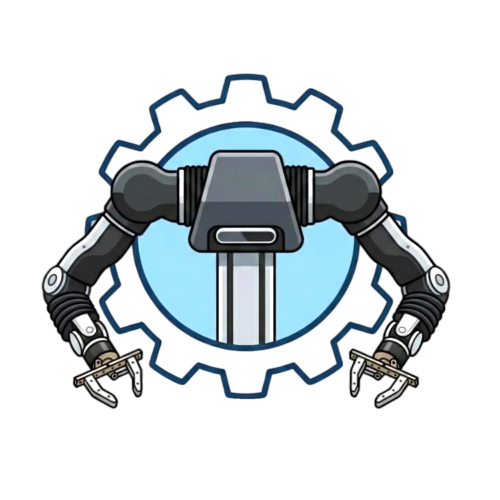

<p align="center">
  
</p>

# openarm_data_collection

Dataset collection for OpenArm teleop via TeleopXR (WebXR / Meta Quest),
recording in **LeRobot codebase v3.0** format, compatible with the
`bi_openarm_follower` conventions of OpenArm LeRobot. **Bimanual** by default;
with `arm:=right|left` it records (and later runs) **a single arm** — see
[Recording a single arm](#recording-a-single-arm).

## Documentation

- Physical arm bringup: [`openarm_ros2`](https://github.com/OpenRob-FURG/openarm_ros2)
- Manipulation stack (MoveIt Task Constructor): [`openarm-mtc`](https://github.com/OpenRob-FURG/openarm-mtc)
- OpenArm simulation / RL: [`openarm_isaac_lab`](https://github.com/OpenRob-FURG/openarm_isaac_lab)
- Arm CAD and assembly: [`openarm_hardware`](https://github.com/OpenRob-FURG/openarm_hardware)
- Dataset format and training: [LeRobot](https://github.com/huggingface/lerobot)

## Dataset schema

Same as the native CAN pipeline (`bi_openarm_follower`), extended to 3 cameras:

| Feature | dtype | shape | content |
|---|---|---|---|
| `observation.state` | float32 | (16,) | `left_joint_1.pos … left_joint_7.pos, left_gripper.pos, right_joint_1.pos … right_joint_7.pos, right_gripper.pos` |
| `action` | float32 | (16,) | same names; **target commanded** by teleop (controllers + grippers) |
| `observation.images.cam_chest` | video | (480,640,3) | chest camera (C270 or RealSense D435i) |
| `observation.images.left_cam_wrist` | video | (480,640,3) | left wrist webcam |
| `observation.images.right_cam_wrist` | video | (480,640,3) | right wrist webcam |

- fps 30, AV1 video (`libsvtav1`), `robot_type: bi_openarm_follower`.
- **Units:** joints are recorded as published by `/joint_states` —
  **radians** by default. The reference `openarm_follower` dataset (CAN
  pipeline) uses **degrees**; to record the same way, see `arm_angle_scale` below.
- **Difference vs. the single-arm reference:** that dataset is 8-dim
  (`joint_1.pos…gripper.pos`, `cam_chest`+`cam_wrist`). This one is bimanual (16-dim,
  3 cameras) — same pipeline and conventions, but a new policy.

## Recording a single arm

`arm:=both|left|right` (default `both`) is a single pipeline parameter: the launch
file forwards the same value to `episode_recorder`, `bimanual_teleop`, and `home_mover`,
and `policy_runner` accepts `arm:=` the same way.

```bash
ros2 launch openarm_data_collection data_collection.launch.py \
    arm:=right task_name:="pick up the lego"
```

| `arm` | `state` / `action` | recorded cameras | `robot_type` | dataset (default) |
|---|---|---|---|---|
| `both` | 16 dims | `cam_chest`, `left_cam_wrist`, `right_cam_wrist` | `bi_openarm_follower` | `~/datasets/openarm_bimanual_vr` |
| `right` | 8 dims: `right_joint_1.pos … right_gripper.pos` | `cam_chest`, `right_cam_wrist` | `openarm_follower` | `~/datasets/openarm_right_arm_vr` |
| `left` | 8 dims: `left_joint_1.pos … left_gripper.pos` | `cam_chest`, `left_cam_wrist` | `openarm_follower` | `~/datasets/openarm_left_arm_vr` |

- **Same names and order as bimanual**: `right` is exactly the slice of the last 8
  dims of `both`. You can train on a slice of the bimanual dataset and run it with
  `arm:=right`, and single-arm datasets remain concatenable with each other.
- The **idle wrist's driver isn't even started** (and the recorder doesn't subscribe
  to it — the synchronizer only fires once *all* subscribed cameras publish, so an
  unused camera going down would otherwise kill the recording).
- Each `arm` gets its **own directory**. If you point `dataset_root` at a
  dataset with a different schema, the recorder **aborts at startup** listing the
  differences, instead of overwriting it.
- `home_mover` moves **both arms** home on startup (moves the idle one out of its
  singularity and into the rest pose visible in the chest camera); after each
  episode only the active arm returns home.
- **Teleop**: the arm outside of `arm` is not instantiated. In `teleop_xr`, omit
  `--wrist-left-topic` / `--wrist-right-topic` for the idle arm (they're optional).
  The **A/B buttons belong to the right controller** — if you're only recording the
  left arm, you teleoperate with the left controller and press A/B with the right one.
- Running: `policy_runner.launch.py … arm:=right` (the checkpoint's action
  dimension must match; otherwise it aborts at startup telling you which `arm` to use).

## Setup (one-time)

```bash
# webcam driver
sudo apt install -y ros-jazzy-v4l2-camera        # realsense2-camera already installed

# Python 3.12 venv with rclpy (ROS) + lerobot in the same process
python3.12 -m venv --system-site-packages ~/openarm_ws/.venv312
~/openarm_ws/.venv312/bin/pip install "lerobot[dataset]==0.6.1" "scipy>=1.13"

cd ~/openarm_ws && colcon build --packages-select openarm_data_collection --symlink-install
```

Why the venv: `lerobot` requires Python ≥3.12 + NumPy ≥2; Jazzy's `rclpy` is
Python 3.12. `--system-site-packages` gives access to `rclpy`. We don't use
`cv_bridge` (it breaks under NumPy 2) — image decoding is handled in
`image_utils.py`.

## Usage

With the robot already in teleop (ros2_control + `teleop_xr` in ROS mode publishing to
the `*_joint_trajectory_controller` and `*_gripper_controller` topics):

```bash
source ~/openarm_ws/install/setup.bash
ros2 launch openarm_data_collection data_collection.launch.py \
    task_name:="pick up the red cup" \
    dataset_root:=/home/popzap-lab/datasets/openarm_bimanual_vr
```

Brings up the RealSense D435i (chest) + 2 wrist cameras (`v4l2_camera` webcam or
RealSense D405, per wrist) + `episode_recorder` + `home_mover`. Verified with real
hardware (2026-09-09): 3 cameras at ~30 fps, episode recorded and validated.

**Camera devices live in `config/recording_params.yaml` (the `cameras:` block)**,
not in the launch file — that's where you edit things when a USB port changes:

```yaml
cameras:
  chest_camera: realsense        # realsense | v4l2
  left_wrist_camera: v4l2        # realsense (D405) | v4l2 (webcam)
  right_wrist_camera: realsense
  wrist_driver: usb_cam          # webcam driver: usb_cam (MJPG) | v4l2 (YUYV)
  chest_serial: ""               # RealSense serial: required if there are 2+ in the launch
  left_wrist_serial: ""
  right_wrist_serial: ""
  left_wrist_device: "/dev/v4l/by-path/...-usb-0:4:1.0-video-index0"
  right_wrist_device: "/dev/v4l/by-path/...-usb-0:10.4:1.0-video-index0"
```

**Warning:** the 2 C270s sometimes disconnect/reconnect on their own (bad
cable/hub contact) and **swap USB ports** when that happens. If a recording comes
out with the wrong camera (or no image), check before editing the yaml:
```bash
ls -l /dev/v4l/by-path/          # current ports
```
and take a test capture from each candidate `/dev/videoN` (the frame content tells
you which wrist it is — e.g. a reference object visible from only one side)
before deciding which port is left/right.

- The C270s share the same factory serial → **`by-id` collides, use `by-path`** (already the default).
  The launch file resolves the symlink to `/dev/videoN` (`usb_cam` doesn't follow symlinks).
- **RealSense on the wrists (D405)**: `right_wrist_camera: realsense` (and/or `left_`).
  Whatever the driver, the wrist image comes out on `/{left,right}_wrist/image_raw`
  (the RealSense is remapped to that) — the recorder, runner, and datasets don't change.
  Cameras can be mixed freely (one wrist D405, the other a webcam).
- **Serials**: with **one** RealSense in the launch, the serial can be left empty. With **two or
  more** (chest + D405) it's required on all of them — otherwise the chest one might open the
  wrist's D405 — and the launch aborts listing what's missing. Find them with
  `rs-enumerate-devices -s` (connecting one device at a time helps tell them apart) and
  put them in the yaml (`chest_serial`, `right_wrist_serial`...) or `right_wrist_serial:=XXXX`.
  The launch already prepends the `_` the driver expects before the serial. RealSense
  cameras come up staggered (3 s apart) so they don't fight over USB enumeration.
  The D405 uses `depth_module.color_profile` (it has no separate RGB sensor); IMU disabled.
- **Chest serial**: the serial has already changed between sessions (different unit, cable
  reconnecting differently) — if you swap the chest camera, update `chest_serial`.
- **RealSense IMU disabled** in the launch: the kernel's `hid-sensor` driver holds
  the gyro/accel (`Permission denied` / `Hid device is busy`). We don't need it.
- **Webcams via `usb_cam` + MJPG** (`wrist_driver:=usb_cam`, default). Verified:
  both C270s on the same USB2 hub at a **clean 30 fps**. With `v4l2_camera` (raw YUYV) the
  two together on the same hub showed **tearing** (torn frames despite `hz`=30) —
  only use `v4l2` if you put the webcams on different USB controllers.

### Controls (Meta Quest, via `xr_buttons`)

| Button | Event | Action |
|---|---|---|
| **A** (tap, right controller) | START | starts an episode |
| **B** (tap, right controller) | STOP | saves the episode, then sends the arms home (`/data_collection/go_home`) |
| **X** (long-press, left controller) | DISCARD | discards the episode in progress |

Episodes shorter than `min_episode_frames` (15) are discarded
automatically. After **B** there's a pause of a few seconds while the
3 videos are encoded to AV1.

### Launch arguments

`arm:=both|left|right` (see above), `cameras:=false` (use your own
drivers), `home_mover:=false`,
`repo_id:=org/name`, `python:=/path`. `chest_camera:=`, `wrist_driver:=`,
`{left,right}_wrist_camera:=`, `chest_serial:=`, `*_wrist_serial:=`, `*_wrist_device:=` override, for a single session, what already comes from
the yaml's `cameras:` block — you normally don't need to pass any of them.

Fine-grained parameters (topics, joint names, `arm_angle_scale`,
`gripper_scale/offset`, `sync_slop`) live in `config/recording_params.yaml`.
To record in **degrees** like the CAN pipeline: `arm_angle_scale: 57.29578`.

## Validation

```bash
~/openarm_ws/.venv312/bin/python -m openarm_data_collection.validate_dataset \
    --root /home/popzap-lab/datasets/openarm_bimanual_vr --dump-episode 0
# or: ros2 run openarm_data_collection validate_dataset --root <path>
```

Checks the schema, episode count/duration/jitter, `state`/`action` ranges,
and (with `--dump-episode N`) saves sample PNGs. The dataset's `arm` is **detected
from the dim names** (both = 16, left/right = 8); `--arm right` requires a specific
arm and fails if the dataset is for a different one.

## Testing the recorded motion (without a model)

Proves that radians + joint order + wiring are correct: republishes the recorded
`action` to the controllers.

```bash
# 1) dry run — doesn't move anything, compares ranges against the URDF limits
ros2 run openarm_data_collection dataset_replay \
    --root <path> --episode 0 --dry-run

# 2) slow replay, easing into the 1st frame first
~/openarm_ws/.venv312/bin/python -m openarm_data_collection.dataset_replay \
    --root <path> --episode 0 --rate-scale 0.25 --goto-start
```

Aborts automatically if the episode exceeds the URDF limits (`--skip-limit-check`
overrides it). Needs the 3.12 venv to read the dataset — `ros2 run` works for
`--dry-run`, but the real replay is better run via `.venv312/bin/python -m ...`.

## Policy deployment

Training is standard: `lerobot-train` reads the dataset directly. **Inference stays in
ROS** (not `lerobot-rollout`/`lerobot-eval`, which instantiate the CAN robot and
conflict with `ros2_control`). The policy runner is a node that subscribes to
`/joint_states` + cameras, runs `PreTrainedPolicy.from_pretrained`, and publishes to the
same topics as `dataset_replay` — going through a safety wrapper (delta clipping +
limits). Not implemented yet.

## Components

| File | Role |
|---|---|
| `episode_recorder.py` | main node: synchronizes `/joint_states` + 3 cameras, builds state/action, records via LeRobot |
| `camera_config.py` | launch-time camera rules (RealSense driver `_XXXX` serial, guards against 2+ RealSense without a serial) |
| `joint_layout.py` | canonical vector layout (`build_slots(arm=)`: 16 dims for `both` or 8 for `left/right`, reindexed from 0) + cameras per arm + URDF limits. Single source of truth: recorder, validate, replay, runner |
| `lerobot_writer.py` | `LeRobotDataset` wrapper (create/resume/add_frame/save/discard/finalize), offline. Refuses to resume a dataset with a different schema |
| `image_utils.py` | `sensor_msgs` → numpy RGB uint8 without `cv_bridge` |
| `xr_buttons.py` | raw TeleopXR events → START/STOP/DISCARD |
| `home_mover.py` | moves the arms home **smoothly** (trajectory with ~80 waypoints, cosine ease-in-out, reads the current pose from `/joint_states`). Trigger: `/data_collection/go_home` or the B button |
| `dataset_replay.py` | republishes the recorded `action` to the controllers (test without a model) |
| `validate_dataset.py` | post-recording check (detects `arm`) |
| `policy_runner.py` | runs a LeRobot policy (ACT, SmolVLA…) on the robot via ROS; `--arm` for 8-dim checkpoints |

## Robot: v1.0

This robot is **OpenArm v1.0**. Bringup:

```bash
ros2 launch openarm_bringup openarm.bimanual.launch.py \
    arm_type:=openarm_v1.0 use_fake_hardware:=false \
    right_can_interface:=can0 left_can_interface:=can1
```

Joint names and arm limits are the same as v2.0. The **gripper is prismatic**
(`finger_joint1`, 0–0.044 m) — on v2.0 it was revolute. `joint_layout.py` already
has the v1 limits.

## Open items / things to review

- **`joint6` (both arms) and both grippers do NOT respond** to commands via
  `*_controller/joint_trajectory` (tested 2026-09-09; j1,j2,j4,j5,j7 move fine).
  The command is sent in the right format — likely an unpowered / torque-off /
  uncalibrated motor. **Review before collecting data** (otherwise those dims stay
  frozen in the dataset).
- **ros2_control does NOT enforce joint limits** ("Enforcing command limits is
  disabled. Command limits from URDF will be ignored") → the **safety wrapper**
  (delta clipping + URDF limits) is mandatory before running a policy.
- **Gripper in raw units** from `/joint_states` (meters, 0–0.044). The reference
  CAN pipeline uses a different scale — adjust `gripper_scale`/`gripper_offset` if
  mixing datasets.
- **Joint zero/sign:** assumes `/joint_states` from ros2_control matches the CAN
  pipeline's calibration. Check against a reference episode in the same pose if
  mixing datasets.
